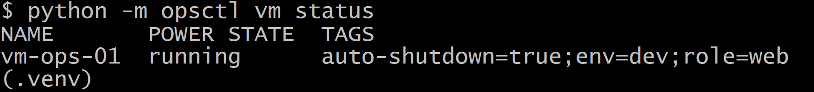
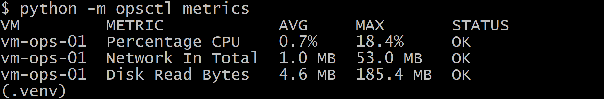
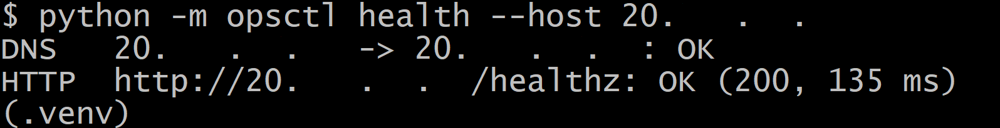
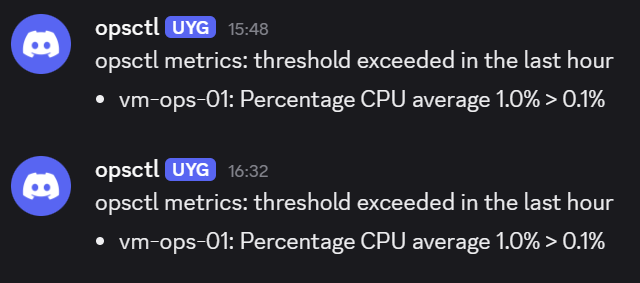
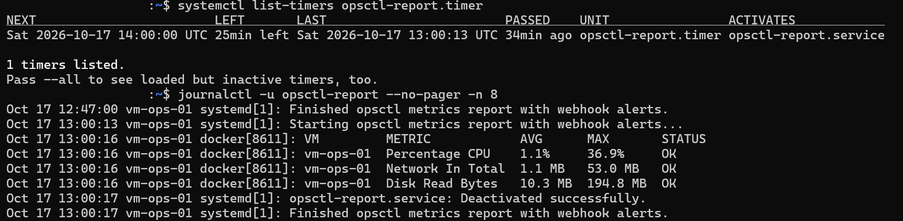
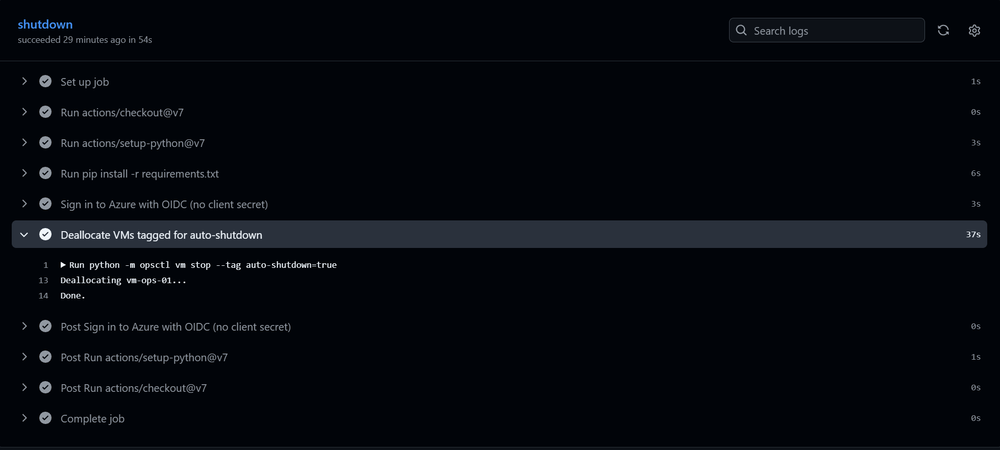

# azure-ops-toolkit

Azure infrastructure scripts and a Python CLI (`opsctl`) for operating a small Ubuntu VM environment: resource inventory, tag-based VM power management, Azure Monitor metrics with a CPU threshold, HTTP/DNS health checks and webhook alerts. The VM runs the CLI hourly through a systemd timer, and a GitHub Actions workflow deallocates it nightly using OIDC federation.

## Architecture

```
GitHub Actions (nightly, 19:00 UTC)
  └─ azure/login (OIDC) ─► opsctl vm stop --tag auto-shutdown=true
                                   │
Azure: rg-ops-toolkit              ▼
  NSG (22, 80)
  vm-ops-01 (Ubuntu 22.04, cloud-init)
    Nginx :80 ─┬─ /healthz ─► 200 "ok"
               └─ /        ─► container "web" (127.0.0.1:8080)
    systemd timer (hourly) ─► docker run opsctl metrics --notify
                                │  managed identity (Reader on RG)
                                ├─► Azure Monitor metrics
                                └─► Discord/Slack webhook on WARN
```

## Screenshots

`opsctl vm status`, `metrics` and `health`:







Webhook alert:



Hourly report on the VM:



Nightly shutdown workflow:



## Project structure

```
infra/
  provision.sh            resource group, VM, NSG rule, managed identity
  cloud-init.yaml         Docker, Nginx and demo container on first boot
  setup-github-oidc.sh    app registration and federated credential for GitHub Actions
  teardown.sh             deletes all project resources
opsctl/
  __main__.py             CLI entry point
  config.py               environment configuration
  inventory.py            resource listing, CSV/JSON export
  vms.py                  power state, tag-based start/stop
  metrics.py              Azure Monitor metrics, CPU threshold
  health.py               DNS and HTTP checks
  notify.py               Discord/Slack webhooks
  formatting.py           table and unit formatting
tests/                    unit tests
deploy/systemd/           opsctl-report.service, opsctl-report.timer
.github/workflows/        nightly-shutdown.yml
Dockerfile
```

## Requirements

- Azure subscription
- Azure CLI (`az login`)
- GitHub CLI (`gh auth login`), for OIDC setup and teardown
- Bash, Python 3.14, Docker

## Setup

### Infrastructure

```bash
bash infra/provision.sh
```

| Variable | Default |
|---|---|
| `RESOURCE_GROUP` | `rg-ops-toolkit` |
| `LOCATION` | `swedencentral` |
| `VM_NAME` | `vm-ops-01` |
| `VM_SIZE` | `Standard_B2ats_v2` |

The script registers the `Microsoft.Insights` provider, creates the VM with `infra/cloud-init.yaml` as custom data, opens port 80 and assigns a system-assigned managed identity with `Reader` on the resource group. cloud-init finishes a few minutes after the VM starts (`cloud-init status --wait`).

### CLI

```bash
python -m venv .venv
source .venv/bin/activate
pip install -r requirements-dev.txt
cp .env.example .env
```

| Variable | Description |
|---|---|
| `AZURE_SUBSCRIPTION_ID` | Target subscription |
| `RESOURCE_GROUP` | Default `rg-ops-toolkit` |
| `WEBHOOK_URL` | Discord or Slack incoming webhook |
| `CPU_THRESHOLD` | CPU average (%) for WARN, default `80` |

Authentication uses `DefaultAzureCredential`: the Azure CLI session locally, the managed identity on the VM, the `azure/login` session in GitHub Actions.

## Usage

```bash
python -m opsctl inventory [--output csv|json]
python -m opsctl vm status
python -m opsctl vm start --tag auto-shutdown=true [--dry-run]
python -m opsctl vm stop  --tag auto-shutdown=true [--dry-run]
python -m opsctl metrics [--notify]
python -m opsctl health --host <PUBLIC_IP> [--notify]
```

- `inventory --output` writes `reports/inventory-<UTC timestamp>.<csv|json>`.
- `vm stop` deallocates VMs. VMs already in the target state are skipped.
- `metrics` reports the last-hour average and maximum of `Percentage CPU`, `Network In Total` and `Disk Read Bytes` per VM. The CPU average is compared with `CPU_THRESHOLD`.
- `health` resolves the host and requests `/healthz` with a 5 s timeout.
- `--notify` sends a webhook message only when a check fails or a threshold is exceeded.
- Exit code is `1` on configuration, authentication, Azure, health or notification failures.

## Docker

```bash
docker build -t opsctl .
docker run --rm --env-file .env opsctl health --host <PUBLIC_IP>
```

The image is based on `python:3.14-slim` and runs as a non-root user.

## Scheduled jobs

### Hourly report (VM)

```bash
docker build -t opsctl .
sudo mkdir -p /opt/opsctl
sudo nano /opt/opsctl/.env
sudo chmod 600 /opt/opsctl/.env
sudo cp deploy/systemd/opsctl-report.* /etc/systemd/system/
sudo systemctl daemon-reload
sudo systemctl enable --now opsctl-report.timer
```

```bash
systemctl list-timers opsctl-report.timer
journalctl -u opsctl-report
```

### Nightly shutdown (GitHub Actions)

```bash
bash infra/setup-github-oidc.sh
gh secret set AZURE_CLIENT_ID --body <client-id>
gh secret set AZURE_TENANT_ID --body <tenant-id>
gh secret set AZURE_SUBSCRIPTION_ID --body <subscription-id>
```

The workflow runs at 19:00 UTC and on `workflow_dispatch`. It authenticates through a federated credential trusted for the `main` branch, with `Virtual Machine Contributor` on the resource group. No client secret is created.

## Tests

```bash
python -m pytest
```

Unit tests mock the Azure SDK clients, HTTP, DNS and time, and do not require network access.

## Teardown

```bash
bash infra/teardown.sh
```

Deletes the resource group and the GitHub Actions app registration, and disables the nightly workflow.

## Known issues

| Error | Resolution |
|---|---|
| `RequestDisallowedByAzure` (region not accepting new customers) | Use another region. Delete the resource group first; its location cannot be changed. |
| `SkuNotAvailable` | Try another size or region. `az vm create ... --validate` checks capacity without creating resources. |
| `Failed to find resource mapping for provider` | `Microsoft.Insights` is not registered, or registration is still propagating. |
| `AADSTS700213` | The OIDC subject does not match. Repositories with immutable subjects use `repo:owner@<id>/name@<id>`; `setup-github-oidc.sh` reads it from the GitHub API. |
| Resource IDs rewritten to `C:/Program Files/Git/...` | Git Bash path conversion. Disabled with `MSYS_NO_PATHCONV=1` where needed. |
